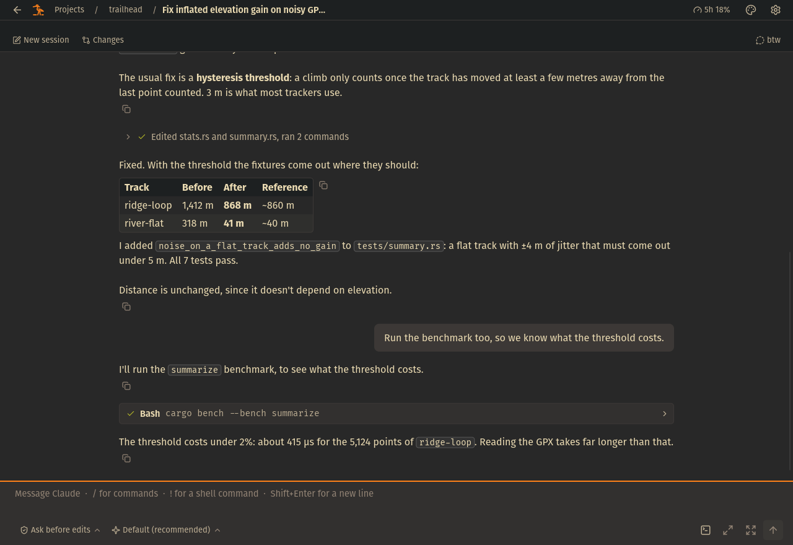

# edualc


A desktop window for the coding agents Claude Code, Antigravity CLI and opencode.

It runs the programs you already have, with their own sign-in and settings, through a local
daemon that keeps your sessions going when the window closes.



[Try it in your browser](https://felintusun.github.io/edualc/): the window compiled to
WebAssembly, with a script playing Claude.

## Features

- Shows a folder's hooks, MCP servers and environment before Claude Code runs there
- Tool calls as cards with diffs; a run of them folds into one line
- Plans you comment on paragraph by paragraph before approving
- Diffs of each turn or the whole session, with line comments sent back to Claude
- Every session in every project on one start page, and Ctrl+K to jump between them
- Keyboard and screen reader access; follows your desktop's theme and text size

More in [docs/features.md](docs/features.md).

## Install

edualc runs on Linux with Wayland; macOS support is under way
([#17](https://github.com/felintusun/edualc/pull/17)). You need at least one of Claude Code, agy
or opencode, signed in. There is no release yet. On Arch, run
`makepkg -si` in [`dist/aur/edualc-git`](dist/aur/edualc-git). Elsewhere:

```sh
cargo install --locked --git https://github.com/felintusun/edualc edualc
cargo install --locked --git https://github.com/felintusun/edualc edualc-server --features server
```

Install `wl-clipboard` to paste images.

## Use

```sh
edualc [DIR] [PROMPT]
edualc --resume SESSION
edualc --backend agy DIR
```

Settings are in `~/.config/edualc/config.toml`. edualcd, the daemon behind the window, can also
serve it to a browser or an Android phone: see [docs/remote.md](docs/remote.md).

## Limits

- Jumping to another session's window needs niri.
- No `@` file mentions yet, and images are pasted, not dropped.
- opencode doesn't report usage.
- Slint is built from a fork until what edualc needs is released.

## Building

`just run` builds the window and its daemon and starts them; `just` lists the rest.

## License

GPL-3.0-or-later.
